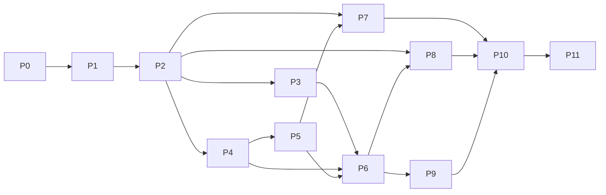

# OrbiTE completion plan

Follow the [product positioning and non-goals](https://github.com/OrbitInfra/OrbiTE#overview):
OrbiTE is the KV data plane for LLM inference on NVIDIA, with OrbitKV cache
tiering and cross-node reuse as its first use case. This plan delivers the
[frozen TENT design](tent-parity.md) through Rust and Python, and records the
evidence for each owner and profile. The upstream path is the proposed
[NIXL backend](nixl-backend.md); P/D acceptance still requires the installed
release gates below. Neither is a current capability claim. MPComm remains deferred.

Native transports use opt-in builds, like `rdma` and `cuda`: a network/memory-only
build must run without file/SSD executors, cuFile or storage SDKs. CPU and
local SSD paths remain supported; no non-NVIDIA accelerator SDK is a dependency.

This is OrbiTE's only status record and execution queue; the parity document
defines requirements. OrbitKV keeps its own cache delivery queue, and this plan
does not duplicate that project's state, storage-policy or adapter roadmap.

## Delivery states

Every substage and every claimed hardware profile has one state:

| State | Meaning |
| --- | --- |
| Planned | Required code or executable acceptance contract is still missing |
| Implemented | Code exists and its source checks pass; required runtime qualification remains open |
| Qualified | The exact installed artifact passed the declared correctness, lifetime, compatibility and resource gates in the recorded profile |
| Accepted | An independent reviewer inspected the diff, reran relevant gates and accepted the evidence and remaining limits |
| Unqualified / Failed | Required hardware or evidence is unavailable, or a gate ran and failed; neither counts as passed |

`orbite 0.1.0-alpha.1` is published on crates.io for early development; its API
is unstable. The source prepares `0.1.0-beta.1`; [release notes](releases.md)
and the API inventories are submitted for maintainer review, with no publication.
[Capabilities](capabilities.md)
summarizes current paths and [qualification](qualification.md) records the exact
artifacts and hardware profiles.

## Delivery sequence

| Stage | Concrete delivery | Prerequisites | Current state |
| --- | --- | --- | --- |
| P0 | Frozen contracts, test mapping and differential oracle | Reference inventory | CPU oracle and native-boundary rejection fixtures implemented; broader differential fault and performance cases open |
| P1 | Rust engine, configuration and resource ownership | Frozen P0 subset | P1.1–P1.5 and S0 implemented; broader P1 open |
| P2 | P2P control plane and standard TCP path | Corresponding P1 substage | P2.1–P2.3 and S0b implemented; broader P2 open |
| P3 | HP-TCP and shared-memory paths | P2 | Complete at source level |
| P4 | Host RDMA, endpoints and multirail foundation | P2 | Source and bounded RoCE profile accepted; physical and fabric gates unqualified |
| P5 | CUDA, GPUDirect, NVLink/MNNVL and staging | P4 | Complete at source level for the frozen cooperative profile. Current installed GPU/RDMA profiles remain in the verification queue |
| P6 | Routing, progress, QoS, deadlines and recovery | P3/P4; staging cases also P5 | Complete at source level. Installed RDMA profiles remain in the verification queue |
| P7 | File, io_uring and GDS paths | P2; GDS also P5 | S1–S5 complete at source level. DRAM/file io_uring qualified in Linux CI. Installed CUDA staging and native GDS gates unrun |
| P8 | Additional CPU/NVIDIA-compatible network providers | P1/P2; relevant P4–P6 | P8.2 libfabric removed and excluded: NVIDIA platforms only; AWS EFA is a non-goal. P8.1 MPComm is deferred: no consumer; provider unavailable |
| P9 | Rust/Python APIs and operations | P0/P2/P6 | OrbiTE configuration and Python CPU/TCP qualified on Linux CI; S19/S20/S22 removed and out of scope |
| P10 | Cross-backend fault and lifetime acceptance | Relevant P3–P9 deliveries | CPU fixture matrix implemented; installed acceptance remains open |
| P11 | Consumer integration, matched performance and release | Accepted P2–P10 profiles | Scoped CPU comparisons implemented; consumer/hardware release gates remain open |

The graph shows dependencies, not one PR per stage. Provider work whose
prerequisites exist can proceed independently, but never inherits another
provider's hardware qualification. Fault testing belongs to each stage; P10
closes the complete matrix. The [release ladder](#release-ladder) defines the
required profiles and evidence for each milestone.

## Current focus

Follow the maintainer's 2026-11-09 order, one PR at a time, stopping for review
after each:

1. **NIXL design alignment — done.** The [backend proposal](nixl-backend.md)
   follows the upstream cancellation, lifetime and TENT-mode discussions.
   No upstream posts, comments, forks or PRs; the maintainer handles them.
2. **Remove libfabric (FABRIC) — done.** Excluded by design: NVIDIA platforms
   only; AWS EFA is a non-goal. CUDA fabric handles, MNNVL and EGM are unchanged.
3. **dma-buf GPUDirect RDMA registration — implemented.** Auto/explicit route
   policy, fd/MR ownership and route evidence have CPU shim controls. The
   [two installed profiles](qualification.md#verification-queue) remain unqualified;
   stop for review before the next item.
4. **Local-copy kernel SM budget and intent-aware Auto.** Wait for its
   separate brief; do not change local-copy scheduling in the removal PR.
5. **Small-WRITE caller CQ wait.** Measure and remove the remaining worker
   handoff only with a bounded completion/drain proof. Keep all retention,
   cancellation, partial-submit and exact-prefix controls.
6. **NIXL plugin implementation.** Requires the upstream explicit-cancel API
   and the outcome of #1958, plus the hardware batch before the formal backend
   RFC: installed GPU/RDMA results for the current artifact and `nixlbench`
   UCX/Mooncake baselines. The maintainer must approve posting the RFC and
   upstream must agree to the design before implementation.
   Target `src/plugins/orbite` in NIXL mainline, using existing OrbiTE owners.
   No custom vLLM/SGLang connectors or fork are part of this plan.

The [direct-I/O comparison](benchmarks.md#direct-io-issue-paths-and-verification-load)
is complete. Its remaining Rust 1.85 gapped WRITE p99 (16.26 ms versus TENT
3.59 ms, overlapping three-trial ranges) is a P11 limit, not a tuning target
on the CI virtual disk. Do no more virtual-disk tail work; measure physical
NVMe tails in the hardware batch.

The [release ladder](#release-ladder) retains the beta API decisions,
test-consolidation and installed acceptance gates. Publication remains the
maintainer's action. Current GPU/RDMA profiles remain in the
[verification queue](qualification.md#verification-queue); prior hardware
evidence applies only to its recorded artifact. Stage details below and the
[design-reference map](tent-parity.md) remain the source-level status record.

## P0 — Freeze contracts and executable comparison

Requirements: all F/B IDs in [the parity contract](tent-parity.md).

Done:

- **P0.1 — shared CPU comparison trace (Implemented).** Unmodified frozen TENT
  and the public Rust API run one deterministic registration, READ/WRITE, batch
  and notification trace over real host memory and TCP; both must match 25
  observations, and six comparator controls must reject broken results. See
  [CPU oracle](cpu-oracle.md). It covers selected valid-input CPU behavior only.

- **S16 — reference fixtures.** Retain the CPU trace contract and three frozen
  request prefixes used by native-listener rejection. Compatibility inventories
  and unused codec/metadata captures are removed; OrbiTE's wire fixtures live
  beside their native owners.

Open:

- [ ] Pin optional-provider SDKs and build options for the profiles outside
  the isolated CPU reference build.
- [ ] Extend the CPU oracle to the remaining native/Python behavior,
  Python guards and tebench byte checks, with hardware triggers where needed.
- [ ] Extend the shared trace to allowed concurrent transitions, faults, broken
  lifetime/epoch controls against independent native and Rust runs.
- [ ] Write the run-manifest schema and freeze workload-specific resource and
  performance guards before formal measurements.

Exit: every in-scope owner has reference paths, negative controls and result formats, and the oracle runs its CPU controls independently of OrbitKV.

## P1 — Core engine and physical ownership

Requirements: F01–F04, F08–F10 foundations, F22.

Done (each Implemented, not Accepted):

- **P1.1 — owned CPU foundation.** Immutable config, random source epochs,
  owned backing, checked ranges and permissions, non-reused registration IDs,
  retained-memory budgets, bounded admission and source close/drain.
- **P1.2 — external host owners.** Retained external allocations, duplicate
  references with TENT's first permission, containing-range lookup and shared
  alias locks.
- **P1.3 — native host batch inputs.** Absolute-address requests resolve and
  retain every range before I/O; host range batches publish atomically.
- **P1.4 — asynchronous batches.** Bounded allocate/append/seal/status/free,
  stable task indices, independent data and notification outcomes, and
  cancellation that never releases running owners; see
  [async batches](async-batches.md).
- **P1.5 — OrbitKV pinned allocation bridge (consumer candidate).**
  [OrbitKV #303](https://github.com/OrbitInfra/OrbitKV/pull/303) exposes one host
  view per real `PinnedAllocation`; two H20 hardware controls passed.
- **S0 — request API and safety hygiene.** `TransferRequest::new` with builders,
  non-exhaustive public types, enforced safety notes and Linux-only native
  features.

Open:

- [ ] Native engine construction from frozen per-engine config, without mutating
  process environment.
- [ ] Explicit separation of logical outcome and physical quiescence for every
  remaining owner, with unregister retry and documented unsafe raw-pointer APIs.
- [ ] CPU allocation, copy and probing. P6 covers merge/alias ownership.
- [x] OrbiTE JSON/file/ORBITE_CONF snapshots, strict types and path diagnostics; TENT compatibility is out of scope.

Exit: CPU property and negative tests, concurrent registration and shutdown
controls, and allocator failure and partial-construction tests pass on
production owners.

## P2 — First complete TCP path

Requirements: B01; F05–F08, F11, F20 foundations.

Done (each Implemented):

- **P2.1 — CPU TCP vertical path.** Epoch-fenced descriptor open/refresh,
  READ/WRITE batches with exact prefix accounting, source validation, final
  WRITE ACK, absolute deadlines and bounded handlers; real loopback and
  independent-process tests.
- **P2.2 — bounded notifications.** Bounded local/remote messages, atomic
  drain, one attached message per successful batch and data results that
  survive notification failure.
- **P2.3 — OrbitKV TCP peer integration (consumer candidate).**
  [OrbitKV #304](https://github.com/OrbitInfra/OrbitKV/pull/304) adds an opt-in
  `orbite-tcp` provider; the limited source/H20 evidence was independently
  accepted.
- **S0b — frozen pre-release wire.** The OrbiTE-only control protocol stays
  frozen throughout pre-release development; see the
  [wire policy](tent-parity.md#wire-and-consumer-boundaries).

Open:

- [ ] Peer identity, descriptor update subscriptions and reconnect semantics.
- [ ] Notification RPC fallback and native C allocation/free conventions.
- [x] Core resource and failure metrics. See [metrics](metrics.md).
- S23 TENT wire interoperability is out of scope by design.
- [ ] Physical two-host TCP qualification.

Exit: real two-process and two-host TCP byte tests, permission/range denial,
restart, reconnect and lost-reply
controls; a lost reply never authorizes ambiguous replay.

## P3 — HP-TCP and SHM

Requirements: B02/B03 with associated F04/F07–F11/F18.

- [x] [HP-TCP](hp-tcp.md) has worker-owned persistent lanes, bounded tasks/bytes/sessions,
  generation-scoped registration IDs, remote permissions, WRITE ACK and READ
  accounting, IPv4 rail validation, per-peer lane rotation, large-READ
  partitioning and static rail pairing, as in TENT.
- [x] [SHM](shm.md) implements shared mappings and offsets, registration permissions,
  alias handling, process lifetime and cleanup, disabled by default.

P3 is complete at source level. Linux CI qualifies loopback HP-TCP and same-host
DRAM SHM on `/dev/shm`, including fragmented frames, restart fencing and
unlink/unregister races. Physical HP-TCP rails and CXL need installed runs.

## P4 — Host RDMA and endpoint ownership

Requirements: B04 host profile; F02/F04/F12/F15/F16/F18 foundations.

QP arrays, persistent multi-context MRs, concurrent grants, transport Workers,
NUMA affinity, multirail slicing, discovery and periodic monitor recovery are
implemented. Source and the bounded RoCE profile were independently accepted at
`121ab95`, including four fresh live repeats; see
[P4 review](qualification.md#p4-independent-review). The detailed P4.1–P4.12m
history is in the
[immutable plan before consolidation](https://github.com/OrbitInfra/OrbiTE/blob/f2c7e7f5d32bb9c231596752af6bd59142b1f3a9/docs/completion-plan.md#p4-implementation-record).

### P4 remaining delivery

| Item | State |
| --- | --- |
| Discovery and recovery correspondence (paused contexts, automatic GID reselection, strict pins) | Implemented; [focused native gate](qualification.md#focused-native-recovery) passed and accepted |
| Declared installed RoCE fault profiles: healthy traffic, idle restart, posted-RQ interruption, lost CQEs, [QP cleanup and in-flight DMA](qualification.md#installed-two-host-fault-qualification), [MR/MW cleanup](qualification.md#installed-memory-cleanup-and-replacement), [CQ/channel/PD cleanup](qualification.md#installed-dependency-cleanup), [rail accounting](qualification.md#installed-physical-rail-accounting), [automatic discovery](qualification.md#installed-automatic-discovery) | Qualified for the frozen installed profiles |
| Physical link/device loss, provider teardown and the InfiniBand profile | **Unqualified**; needs authorized disposable hardware |

These results have distinct meanings. Posted-RQ interruption proves
authorization drain before payload; lost CQEs prove recovery after lost engine
observation; neither proves termination of physically interrupted DMA. Process-
local syscall and dependency faults prove retention, not spontaneous hardware
error coverage. RoCE results never satisfy the InfiniBand profile. Priority,
spraying and retry policy belong to P6, GPU paths to P5/P7 and native API/wire
public API review to P9.

## P5 — CUDA, GPUDirect and staged transfers

Requirements: B01 device directions, B04 CUDA, B05/B06; F02–F04/F07/F19.

Done:

| Substage | State | Evidence |
| --- | --- | --- |
| P5.1 NVIDIA allocation and synchronized staging | Implemented, including exact caller-context restoration | [CUDA copy](qualification.md#cuda-copy-streams-and-completion-events) |
| P5.2 Owned copy streams and completion events | Local-copy profile qualified (24 H20 cases) | [CUDA copy](qualification.md#cuda-copy-streams-and-completion-events) |
| Owner-backed CUDA pointer/location metadata | Implemented | [pointer and location](qualification.md#cuda-pointer-and-location) |
| CUDA topology and owner-based RDMA selection; custom topology input | Implemented | [topology](qualification.md#cuda-topology-and-rdma-selection), [custom input](qualification.md#custom-topology-input) |
| P5.3 Explicit GPU direct RDMA | Bounded H20/RoCE profile accepted with a host-context inventory limit | [GPUDirect](qualification.md#gpudirect-rdma) |
| P5.4 Cooperative CUDA IPC/NVLink | Original profile accepted (48 cases). Single small synchronous copies implemented, installed profile unqualified | [cooperative IPC](qualification.md#cooperative-cuda-ipc-and-nvlink) |
| P5.4b Subbatch import reuse | Accepted (28 cases) | [subbatches](qualification.md#bounded-cuda-ipc-subbatches) |
| P5.4c Local pinned host directions | Accepted (30 cases) | [pinned host](qualification.md#local-pinned-host-cuda-ipc) |
| P5.4d Cross-submission import cache | Fixed working set accepted (34 cases); LRU reclaim and flush implemented | [cache](qualification.md#bounded-cross-submission-cuda-ipc-cache), [reclamation](qualification.md#cuda-ipc-cache-reclamation) |
| P5.4e–h Grouped completion, shared stream pool, event progress, native batch copy | Implemented | [group](qualification.md#cuda-ipc-group-completion), [streams](qualification.md#cuda-ipc-stream-pool), [events](qualification.md#cuda-ipc-event-progress), [batch](qualification.md#cuda-ipc-native-batch-copy) |
| P5 MNNVL and EGM (B06) | Implemented; installed profile unqualified | [Fabric and host-NUMA verification](qualification.md#multi-node-nvlink-fabric) |
| P5.5a Local staging chunks | Accepted (24 cases) | [local chunks](qualification.md#local-cuda-staging-chunks) |
| P5.5 Source resource and control boundaries | Implemented; installed profile unqualified. Source session isolation, bounded Pin capacity, drain and quarantine follow the [staging contract](staging.md#remote-delegate-progress). | [Verification queue](qualification.md#verification-queue) |
| P5.5b Remote staging | Serial (16 cases) and ≤16-slot pipeline (24 cases) accepted; later requester ring, shard, event-loop, concurrent CROSS, Delegate query and pollable setup/finish work source-accepted only | [serial](qualification.md#serial-remote-cuda-staging), [pipeline](qualification.md#bounded-remote-cuda-pipeline) |
| S15b caller-stream copy extension | Implemented; installed profile unqualified | [API and ownership](local-copy.md), [matched GPU gate](qualification.md#caller-stream-local-cuda-copy) |
| Mixed direct/staged batches, per-request remote staging, GPU and pinned producer readiness | Implemented; installed profile unqualified | [mixed](qualification.md#mixed-gpu-batches), [remote selection](qualification.md#per-request-remote-staging), [readiness](qualification.md#cuda-producer-readiness) |

P5 is complete at source level for the frozen CPU/NVIDIA cooperative profile.
Mixed CUDA paths preserve ordered handoffs even when the outer ranges abut.
GPU source QP/MR reuse requires explicit opt-in and hardware key revocation.
Legacy NVLink IPC covers remote device allocations and requires the exporter
to remain alive until importers close. Remote host-NUMA exports use MNNVL/EGM.
Legacy remote host export and recovery after exporter death remain outside
this source-level claim. See [CUDA IPC scope](cuda-ipc.md#correspondence-to-tent).

Installed qualification remains open for every implemented-only row and for
native GPU fault injection. See the [verification queue](qualification.md#verification-queue).

Exit: full device byte/sentinel assertions, independent producer/consumer
processes, CUDA/GDR/NVLink/MNNVL profile tests, context and copy failures,
partial submission, delayed completion, cancel, teardown and generation reuse.
CPU shims cannot pass this stage's device gates.

## P6 — Complete runtime behavior

Requirements: F08–F20; every implemented transport consumes the same owners.

Source-level exit complete. The following contracts have CPU controls.

- **Transport selection (S6, F12/F13).** First-match and named policies use
  segment, original memory types, size, effective priority, intent and boot
  identity. Strict hints, per-request NIC masks and endpoint QP pools reach
  the executing owner. Installed two-RNIC qualification is queued.
  See [transport selection](transport-selection.md).
- **Transport failover (S9, F17).** Each physical owner pins its policy,
  budget, epoch and registration. Submit and completion retries require
  owner-specific release evidence. See [transport attempts](async-batches.md#transport-attempts).
- **Physical admission and merge (S8, F08/F14).** Registered contiguous ranges
  share a physical owner across public task IDs. FIFO/EDF tracks physical
  windows, internal staging reserves, credit and QoS permits. The optional
  deadline threshold uses transport-specific rates. Drops are visible on every
  alias, and unquiesced native work stays charged.
- **Priority and arbitration.** RDMA High/Medium/Low dispatch across contexts,
  TENT's urgency ordering, head-only or per-entry aging and shared priority
  slots; TCP and NVLink accept every priority as advisory. CPU ordering controls
  synchronize at the whole-worker snapshot boundary and cover late registration.
- **QoS contracts.** Typed and OrbiTE JSON global/tenant/intent policies
  with per-contract byte/request caps and delay/reject admission.
- **Quotas and credits (S11, F15).** Each NIC accounts its own slices. Host
  processes share the mapped priority slot. The sender ledger atomically
  reserves four named resources. Fixed receiver windows and remote Pin
  staging/consumer charges retire only on confirmed drain. TENT receiver credits
  use fixed windows and have no cluster byte allocator or dead-sender reaper.
  The opt-in v0.3.14 congestion core exposes device and route windows to callers.
  The released TENT RDMA workers have no call site for it.
- **Progress and notifications (F09/F11).** One bounded progress turn,
  observational status, optional event worker, deferred retirement and
  target-specific notification receipts with transport and control RPC fallback.
- **Metrics (S10, F20).** The opt-in OrbiTE exporter records physical attempts, logical results, failure reasons and bounded-owner gauges. CPU and TCP measurements compare disabled and enabled recording. See [metrics](metrics.md).
- **RDMA rail health (S9, F18).** A pair-level circuit under the existing
  context monitor gates new slices. Recovery requires a native probe receipt.
  Real link-loss qualification is queued. See [rail health](rdma-cuda.md#rail-health).
- **Bandwidth-aware spraying.** Topology penalties, strict locality, rate-seeded
  EWMA, weighted whole-parent distribution, periodic rail exploration and
  effective link-rate discovery.

Exit evidence includes real TCP credit loss, deterministic rail faults and
alias accounting, plus two Linux processes sharing a tmpfs slot through
publisher death. The [verification queue](qualification.md#verification-queue)
retains installed RNIC selection and QP pools, shared slots and receiver
credits under contention, transport failover and physical rail faults.
Hardware fairness and throughput still need measurement.

## P7 — Storage transports

Requirements: B07/B08 and F05 file-segment behavior. These paths are core:
OrbitKV's SSD tier moves its DRAM↔SSD and GPU↔SSD bytes through them, while
OrbitKV keeps extents, placement, eviction and recovery policy.

- [x] **P7.1 — local file segments (Implemented).** Engine-local `file://`
  segments with cached size and refresh, permissions, checked byte offsets and
  close that drains pending fd users. See [file segments](storage.md).
- [x] **P7.2 — DRAM/file io_uring (Qualified on Linux CI).** One ring per submission,
  exact short/error byte counts, partial submission, queued cancellation and
  CQE drain before releasing registered memory or file leases. Small host
  submissions can consume a ready CQE on the caller; pending work hands the
  existing ring to the batch worker without resubmission.
- [x] **P7.3 — CUDA/file staging (Implemented).** An optional file pool supplies whole-request pinned slots. Larger requests and pool misses use caller-driven rounds of
  charged pinned chunks, device-range loans and event-confirmed copyback.
  The installed GPU/NVMe profile is unqualified.
- [x] **P7.4 — GDS/cuFile (Implemented).** Registered CUDA buffers and direct
  file handles, sliced READ/WRITE, cancellation and drain. The installed
  native-route profile is unqualified.
- [x] **P7.5 — build isolation and BufIo audit (Implemented).** File handles
  stay core. File vectors share a logical receipt across registered ranges and padding.
  Runtime-disabled GDS skips cuFile discovery. CI checks the dependency graph, unavailable hints and idle
  storage resources. BufIo is unreachable through the frozen loader.

The [qualification record](qualification.md#local-file-segments) links the
ext4/tmpfs evidence and the queued GPU/NVMe and native GDS commands.

## P8 — Additional network providers

Neither additional provider is in the current scope. Non-NVIDIA accelerators,
UB/URMA and dependent transports are excluded without public identities.

| Substage | Required implementation | Parity IDs | Hardware acceptance |
| --- | --- | --- | --- |
| P8.1 | Deferred: no consumer; provider unavailable. No public identity or provider | B15 | No verification gate; revisit with a consumer, provider and hardware |
| P8.2 | Removed and excluded by design: libfabric / FABRIC | B17 | NVIDIA platforms only; AWS EFA is a non-goal. Revisit only for a direct AWS consumer with GPU FI_HMEM from the start; see [scope](tent-parity.md#upstream-transport-inventory-and-selected-scope) |

Neither row has a current implementation gate. A future scope decision must
establish a consumer, GPU memory support, bounded owners and physical drain
before a provider is reintroduced.

## P9 — Rust and Python APIs

TENT API, ABI and configuration compatibility are out of scope by design.

- [x] Immutable OrbiTE JSON/file/ORBITE_CONF snapshots, strict keys and types.
- [x] Rust-shaped Python owners, batch operations, notifications, file segments
  and statistics; typed errors, GIL release and exporter lifetime through drain.
  Retained CAI/DLPack owners validate native bounds and producer readiness.
  Native GPU profiles remain unqualified.
- [x] Consumer-owned discovery and authoritative endpoint/epoch input.
- [x] Rust per-peer close fences admissions, drains owners and retires caches.
  Live references bound identity charges; uncertain cleanup stays charged.
  Python segment close releases a handle. RNIC/CUDA retirement remains unqualified.
- [x] OrbiTE metric names with bounded recording, labels and histograms.
- S19, S20, S22 and S23 are removed and out of scope.

Exit: independent Rust and Python consumers exercise installed artifacts with
explicit provider/feature matrices and physical-lifetime negative controls.

## P10 — Fault and physical lifetime acceptance

Runs throughout P2–P9. The [release ladder](#release-ladder) requires acceptance
for each release's supported profiles; full parity closes the complete matrix.
S26 maps existing controls in [the CPU fixture list](benchmarks.md#cpu-fault-matrix),
adds real socket peer kills, and queues installed GPU/RDMA/GDS receipt faults.
CPU execution is preparation, not acceptance of the hardware matrix.

- [ ] Separate known-unsubmitted rejection and cancel from partial post, running
  work, logical error, physical quiescence and completed cleanup.
- [ ] Requester/source crash, delayed/lost/duplicate replies, mid-payload
  disconnect, same-address restart, stale registrations and admission exhaustion.
- [ ] Failed register/deregister, endpoint/context destruction, worker and
  handler shutdown, device loss and late completions after cancellation.
- [ ] For failover, prove the earlier attempt can no longer modify destination
  memory before replay, and prove eventual reclamation for each claimed path.
- [ ] Same-host, two-host, multirail, storage, device and fabric profiles, plus
  cross-backend fault and lifetime controls; keep failed runs and counterfactuals.

Exit: per-profile accepted evidence of correct bytes, monotonic authority,
bounded ownership, no early reuse and eventual cleanup.

## P11 — Consumers, performance and release

Requirements: F22 and the applicable accepted backend and consumer profiles.
S26 implements reproducible, byte-checked CPU/TCP/io_uring comparisons against
frozen TENT, plus OrbiTE HP-TCP/SHM sweeps ([method](benchmarks.md)). The CPU
performance pass implements bounded TCP stream reuse and small ready file
completion. The [ext4 reset comparison](benchmarks.md#ext4-tail-diagnosis)
removes harness writeback from the timed window and exposes a real direct-I/O
WRITE gap: gapped 64×4 KiB p99 is 33.0/26.0 ms versus TENT 1.8/1.8 ms;
contiguous p99 is 14.1/18.0 ms versus 4.0/6.2 ms (stable/Rust 1.85).
The [block-layer comparison](benchmarks.md#direct-io-issue-paths-and-verification-load)
reproduces the gapped tail in unchanged TENT by matching verification reads.
Both harnesses now use bulk verification; the earlier numbers describe the
prior verification regime. No production tuning is claimed. The remaining
work and measurement limits are in [Current focus](#current-focus). These
scoped runs make no general performance claim. Add NIXL UCX and Mooncake plugin comparisons during the
hardware pass; the [design proposal](nixl-backend.md) adds no NIXL dependency.

- [ ] Run OrbitKV against an installed artifact through its transfer owner,
  preserving the still-needed source-epoch and source-close contracts. A scoped
  installed prerequisite was accepted at consumer `eb1cc90f`
  ([OrbitKV #307](https://github.com/OrbitInfra/OrbitKV/pull/307)).
- [ ] Meet the [NIXL prerequisites](#current-focus), then the purpose-built
  plugin/bridge and its CPU byte/lifetime controls; installed GPU/storage
  plugin profiles remain separate from native qualification.
- [ ] Matched TENT/OrbiTE comparisons (small/large, fragmented, READ/WRITE,
  cold/warm, mixed priority, CPU/device/file, multirail). Initial guards:
  goodput ≥ 0.95, p99 latency ≤ 1.05 and CPU-per-byte and peak-RSS ≤ 1.10 of the
  frozen reference, ratified in P0 before formal runs.
- [ ] Packaged crates, CLI and wheels tested outside the
  checkout, with provider discovery, runtime paths and provenance.
- [ ] Installed manifests prove no C++ Mooncake engine/common/Store dependency.

### Release ladder

The maintainer publishes releases when their gates are met. Agents do not
publish packages.

| Version | Release gate |
| --- | --- |
| `0.1.0-alpha.N` | Maintainer-published milestones during early development; APIs remain unstable. The current release is `0.1.0-alpha.1`, published from main [`7cc48490`](https://github.com/OrbitInfra/OrbiTE/commit/7cc48490). |
| `0.1.0-beta.1` | S21, S26 and per-peer retirement are complete; S24 is removed and out of scope, and S25 is deferred. The [Rust](rust-api.md#beta1-freeze-candidate) and [Python](python.md#surface-and-defaults) APIs are the freeze candidate; the [freeze decisions](rust-api.md#freeze-decisions) settle extensibility, names and hidden binding/core boundaries. TCP, HP-TCP, SHM, io_uring, configuration and Python CPU/TCP are qualified in their stated Linux CI profiles. Publication requires review of the prepared version, notes and packaging gates. Current GPU, RDMA, GDS, MNNVL/EGM, CXL and physical fabric profiles remain explicitly unqualified. |
| Test consolidation (after the beta.1 API freeze) | Audit `tests/unit` (about 72k lines) for repeated assertions of the same invariant through the same owner, often added by different steps; merge them into table-driven tests. Preserve every negative control and distinct failure path: timeout, cancel, partial submit, `Unquiesced`, stale epoch and each deliberate TENT difference. CPU shims and `tests/hardware` gates are out of scope. Report source/test line deltas and invariant counts before/after; the invariant count must be unchanged. Tests-only refactor: no production change and no coverage drop. |
| API documentation closure (before `0.1.0`) | Close remaining public missing-docs findings across every feature set, then make the CI rustdoc audit enforce `-D missing-docs` on stable and Rust 1.85. Documentation additions are non-breaking and do not block beta.1. |
| `0.1.0` | Installed hardware verification passes for the OrbitKV-critical profiles below. The [P10 fault matrix](#p10--fault-and-physical-lifetime-acceptance) must pass on those profiles, and [P11 performance comparisons](#p11--consumers-performance-and-release) must be matched against frozen TENT. |
| Post-0.1.0 P/D acceptance | After installed GDR/NVLink qualification, validate the [NIXL integration](nixl-backend.md) with inference consumers: decode-page abort/reuse safety, joint P/D and cache arbitration, and TTFT/ITL against NIXL+UCX and Mooncake. The backend design and upstream agreement happen earlier under [Current focus](#current-focus); OrbiTE ships no custom P/D connector. This remains a plan, not implemented or qualified integration. |

Beta evidence uses the [TCP and configuration jobs](qualification.md#linux-ci-release-profiles),
[source and oracle checks](qualification.md#reproduce-and-review),
[HP-TCP](qualification.md#hp-tcp-rail-verification),
[SHM](qualification.md#shared-memory-and-cxl-verification) and
[io_uring](qualification.md#local-file-segments) and
[Python wheels](qualification.md#python-wheels) profiles. A source implementation
or shim does not satisfy an installed hardware gate.

The [verification queue](qualification.md#verification-queue) owns the commands
and artifact requirements for the stable release; they are not duplicated here.

| Required `0.1.0` profile | Existing verification-queue entries |
| --- | --- |
| RDMA host | {ref}`Installed host artifact and terminal QP/MR teardown <queue-rdma-host>` |
| RDMA GPU Direct and staged | {ref}`GPU Direct host-wide context non-growth <queue-gpudirect>`, {ref}`remote CUDA staging <queue-remote-staging>`, {ref}`mixed direct/staged batches and producer readiness <queue-mixed-gpu>` |
| S15b local CUDA copy | {ref}`Caller-stream local CUDA copy <queue-local-cuda-copy>` |
| S3 GPU↔file staging | {ref}`CUDA↔file through DRAM staging <queue-cuda-file>` |
| S4 native GDS | {ref}`Native GDS with nvidia-fs route evidence <queue-native-gds>` |
| NVLink | {ref}`Legacy single-copy path and context restoration <queue-nvlink-sync>`, {ref}`grouped completion and cache reclamation <queue-nvlink-grouped>` |
| P10 faults and P11 matched performance | {ref}`Release verification entry <queue-release>` |

`0.1.0` may also ship [MNNVL/EGM](qualification.md#multi-node-nvlink-fabric),
{ref}`CXL <queue-shm-cxl>` and
physical multi-rail ({ref}`RDMA <queue-rdma-rails>` and
{ref}`HP-TCP <queue-physical-rails>`) as **experimental
and unqualified**, listed by name in the release's support matrix. Their open
gates do not waive verification of the OrbitKV-critical profiles above.
A CPU-only `0.1.0` is not planned; it requires an explicit maintainer decision
if hardware remains unavailable.

The explicit compatibility policy begins at `0.1.0`: peers of the same
`0.1.x` series interoperate, and the control-plane wire version stays frozen
across that series. A breaking wire or Rust API change requires a minor-version
bump under 0.x semver. Until `0.1.0`, deploy the same build on both peers under
the [pre-release wire policy](tent-parity.md#wire-and-consumer-boundaries).

**Complete NVIDIA-scope design implementation** requires every in-scope capability to be
accepted; it never claims the excluded accelerators or UB. A slower or
unqualified feature is recorded as such.

## Historical OrbitKV contracts

At OrbitKV `a9befeec596bb9064d25d34f93d07fe59077809d` the audited transfer owner
needs stable allocator registration, P2P segment lookup, batched READ,
authoritative source epochs, source close/drain, generation-scoped
notifications and NIC-load observations; OrbitKV keeps its generation scopes and
mailbox policy. Consumer PRs #303 and #304 pin OrbiTE `02d64e55`; their evidence
lives under `/root/orbitte-artifacts/` and is valid only for those artifacts.

## Required gates and evidence

| Gate | Trigger | What it may establish |
| --- | --- | --- |
| Source/CPU | Every implementation PR | Local contracts, property and concurrency tests, Rust checks |
| Real process/TCP/SHM/file | Control, TCP, memory, storage or lifecycle changes | Real cross-process bytes, errors, protocol and owned shutdown |
| P2P discovery boundary | F06 configuration or consumer API changes | External stores rejected; consumer-issued endpoint and epoch authority preserved |
| RDMA/device/storage/provider | Corresponding implementation changes | Real backend bytes and hardware-specific completion and lifetime |
| Cross-language | API or binding changes | Installed Rust and Python caller behavior and lifetimes |
| Matched performance | Hot-path, scheduling, metrics or release changes | Measured benefit or regression for the recorded profile only |
| Final installed artifact | Every supported release profile | Real package, runtime dependency and loader behavior |

The [contributor guide](contributing.md) and
[agent gates/handoff](https://github.com/OrbitInfra/OrbiTE/blob/main/AGENTS.md#5-gates-for-every-pr)
own reproduction and review instructions. [Architecture](architecture.md)
owns the source/owner map; [qualification](qualification.md) owns artifact
evidence and limits. No gate may silently skip the profile it claims.
